# Petros CH32H417W Logic Alef开发板使用手册

本手册介绍Petros CH32H417W Logic Alef开发板的使用方法。

## 1. 产品介绍 - Overview

CH32H417是由南京沁恒公司开发的32位微控制器，用于开发嵌入式产品。其最大的特点在于支持USB3.0高速接口与RISC-V双核架构。正是因为这两个特点，[**XPU实验室**](https://xpulabs.taobao.com)开发了**Petros CH32H417W Logic Alef**开发板。

Petros CH32H417W Logic Alef开发板使用的是CH32H417WEU6微控制器。它是QFN68的封装，板形外观兼容树莓派RP2040 Pico的直插的板形，其大小为52mm x 21mm，非常小巧。带有一个USB3.0 Type-C母座高速接口，支持正反插，用于开发USB3.0高速设备。实际测试USB3.0接口下行速度为450MB/s, 对于高速数据采集十分实用。板上的板对板连接器主要引出部分UHSIF接口，用于逻辑仪开发使用。所有GPIO都经过连接器引出，100Mbps以太网接口通过测试点引出。

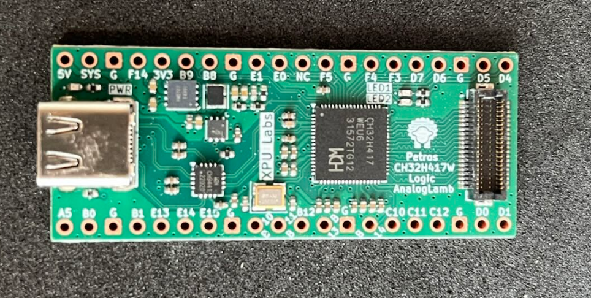

## 2. 芯片特点 - Features

- 双内核结构：青稞RISC-V5F和RISC-V3F

- V5F最高频率400MHz，V3F最高频率150MHz

- 896KB SRAM，960KB Flash

- 系统供电额定3.3V、常规GPIO供电额定3.3V，支持1.8V、高速GPIO供电可选1.2/1.8/2.5/3.3V

- 2组共16路通用DMA控制器

- 2组12位模数转换ADC，采样速率高达5Msps，支持双ADC转换模式

- 1组10位高速模数转换HSADC，采样速率高达20Msps

- 32位宽度125MHz通用高速接口UHSIF

- 150MHz数字图像接口DVP

- 200MHz双沿SD/EMMC控制器（SDMMC）

- SDIO主机/从机接口：支持SD/SDIO/MMC口

- 以太网控制器MAC及10M/100M PHY

- 5Gbps超高速USB 3.0控制器及PHY

- 480Mbps高速USB 2.0控制器及PHY

- 全速USB 2.0控制器及PHY

- 远距离SerDes控制器及PHY，支持千伏级高压信号隔离传输

- USB PD和Type-C控制器及PHY

- 8组USART串口、4组I2C接口、1组I3C接口

- 4组SPI接口、2组QuadSPI接口、3组CAN接口（2.0B主动

- 串行音频接口SAI

- LCD-TFT显示控制器LTDC

- 图形处理硬件加速器GPHA

- 灵活存储控制器FMC

- 95个I/O,映射16个外部中断

- 支持单线（默认）和双线两种调试模式

## 3. 产品规格 - Specifications

- 主芯片：CH32H417WEU6 QFN68 双核USB3.0 RISC-V
- USB3.0 Type-C接口，支持正反插
- 板载DC-DC，输出3.3V@1A
- 板载VIO18可调输出DC-DC，通过DAC调节VFB
- 100%兼容树莓派Pico板的外形
- 板对板连接器扩展逻辑分析仪模块，用于逻辑分析仪使用
- 所有GPIO都已经引出，方便开发
- 100Mbps以太网接口通过测试点引出
- 板对板连接器引出16个UHSIF和4个ADC接口
- 可通过USB3.0 Type-C口连接LinkE下载固件
- 调试接口引到2.54排针上
- 配套多接口Link-E调试器，即插即用
- 尺寸：52mm x 21mm

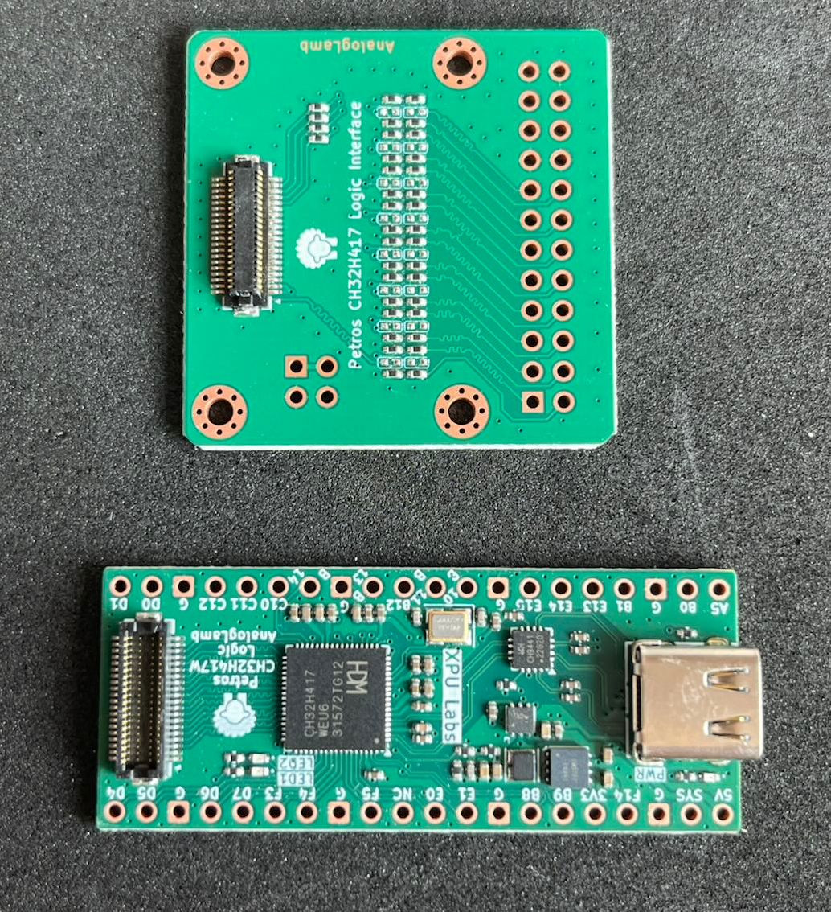

## 4. 硬件 - Hardware

**CH32H417WEQ6的管脚定义**

**资源接口**

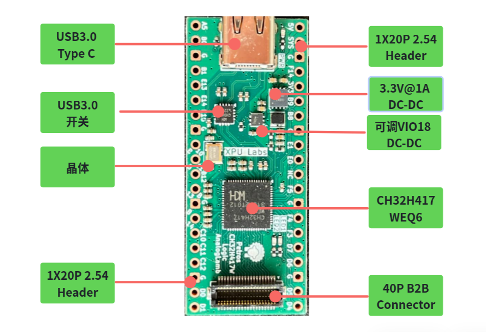

**引脚**

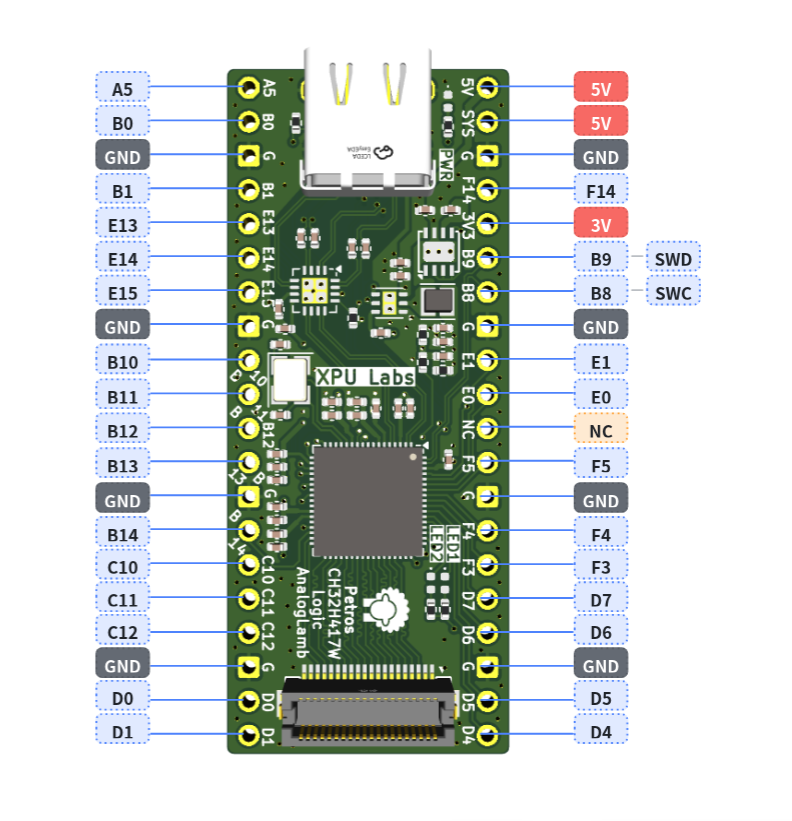

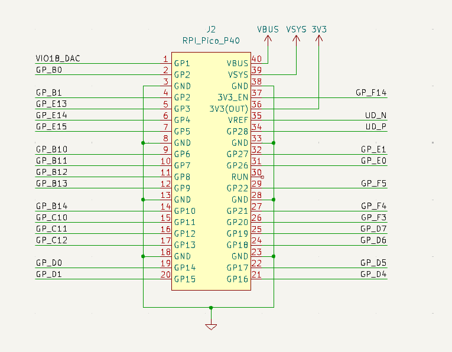

40P板对板连接器管脚定义如下，使用的连接器为HRS的**DF12NB(3.0)-40DP-0.5V(51)**

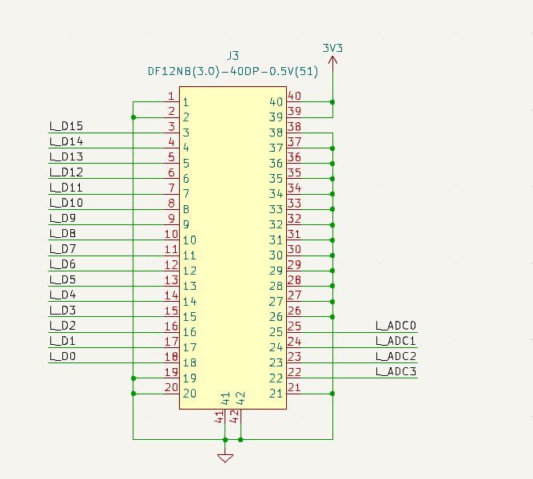

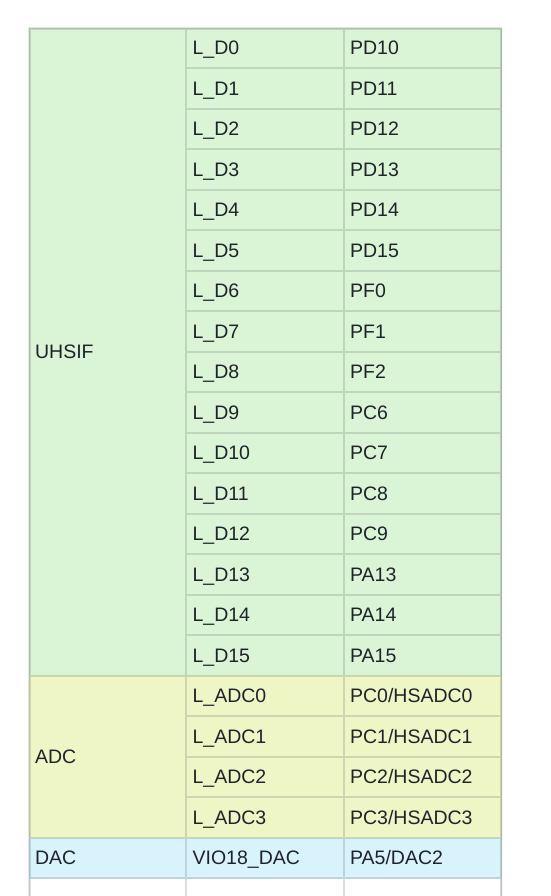

这个接口目前可以连接-逻辑分析仪接口模块，为了便于固定开发板，我们设计了相应的外壳。

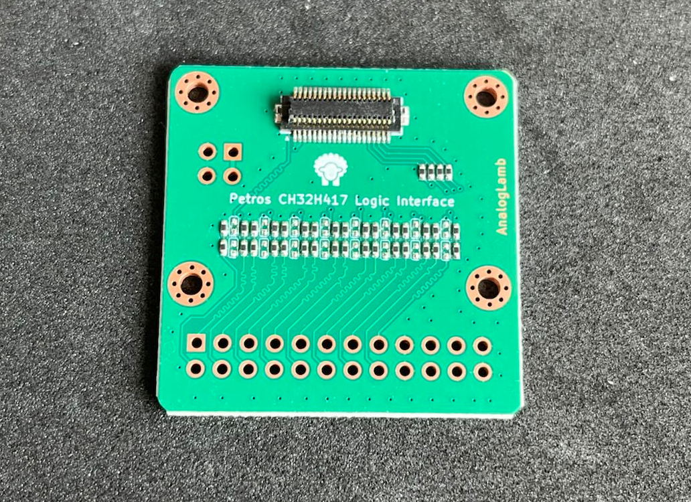

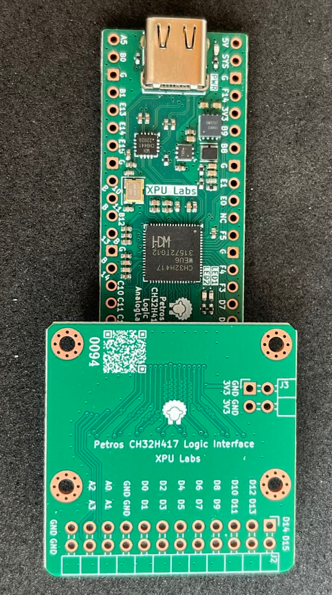

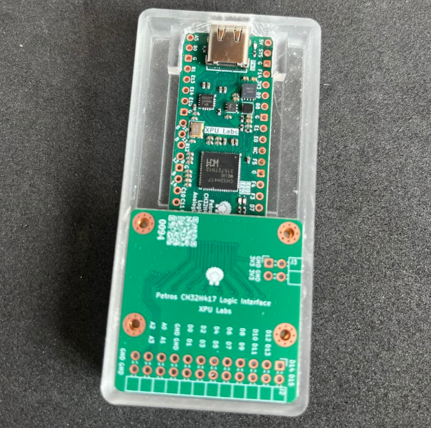

## 5. 软件开发 - Software

CH32H417使用MounRiver II IDE集成开发环境，支持Windows & Linux. 

调试器需要使用Link-E 1V3, XPU实验室开发相应的调试器，可以直接通过杜邦线连接到的B8、B9脚上（2.54mm排针）SWD调试接口上。

更推荐通过普通的USB2.0 Type-C口外接排针，连接到Link-E上。

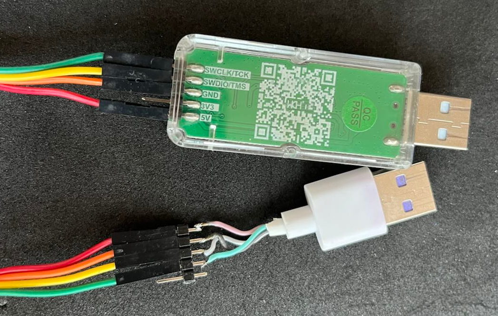

只需要将USB2.0 Type-C口插到板子的USB3.0 Type-C口上即可。

## 6. 教程 - Tutorials

- [B站 - CH32H417极速上手系列视频教程](https://space.bilibili.com/402444620/lists?sid=7939010&spm_id_from=333.788.0.0)
  
  - [【5分钟极速上手】CH32H417点灯教程：零基础完成你的第一个嵌入式项目](https://www.bilibili.com/video/BV1AqoFB7ELC/?spm_id_from=333.1387.collection.video_card.click&vd_source=ed48992440952cbd7721bdfd510c25e1)
  
  - [【硬核实测】CH32H417的UHSIF接口到底多快？5分钟带你跑出330MB/s真实速度](https://www.bilibili.com/video/BV1pJovB1EhR/?spm_id_from=333.1387.collection.video_card.click&vd_source=ed48992440952cbd7721bdfd510c25e1)
  
  - [【深度解析】5分钟彻底搞懂CH32H417双核工程！MounRiver的Solution原来这样玩](https://www.bilibili.com/video/BV18rRuBmER6/?spm_id_from=333.1387.collection.video_card.click)
  
  - [CH32H417 10分钟彻底搞懂HSEM！双核同步与通信的终极方案](https://www.bilibili.com/video/BV1TqLJ6CEq9/?spm_id_from=333.1387.collection.video_card.click&vd_source=ed48992440952cbd7721bdfd510c25e1)
  
  - [10分钟彻底搞懂CH32H417中断与事件系统](https://www.bilibili.com/video/BV1SrEd64Edn/?spm_id_from=333.1387.upload.video_card.click)
  
  - [CH32H417 10分钟彻底玩转ADC 从零基础到定时器精确定时采集](https://www.bilibili.com/video/BV13SKS6yELh/?spm_id_from=333.1387.upload.video_card.click)

- B站-相关短视频
  
  - [是CH32H417开发板也是USB3.0逻辑分析仪](https://www.bilibili.com/video/BV1tstZ6JEjD/?spm_id_from=333.1387.upload.video_card.click)
  
  - [USB Type-C的CH32H417开发板&逻辑分析仪来了](https://www.bilibili.com/video/BV1Eda165Edb/?spm_id_from=333.1387.upload.video_card.click)
  
  - [带壳的ch32h417逻辑分析仪，只要几十元，16ch@200MHz](https://www.bilibili.com/video/BV1uYHs6VEQj/?spm_id_from=333.1387.upload.video_card.click)
  
  - [沁恒CH32H417诚不欺我450MB/S速率达到了](https://www.bilibili.com/video/BV1NVNz6vEnd/?spm_id_from=333.1387.upload.video_card.click)

视频持续更新中.....

## 7. 资源 - Resources

- **原理图**

- **例程**

请联系[ **xpulabs.taobao.com** ](https://xpulabs.taobao.com)淘宝店客服

## 8. 常见问题 - FAQ

持续更新中.....
