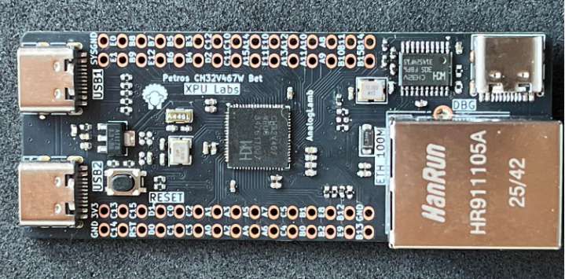
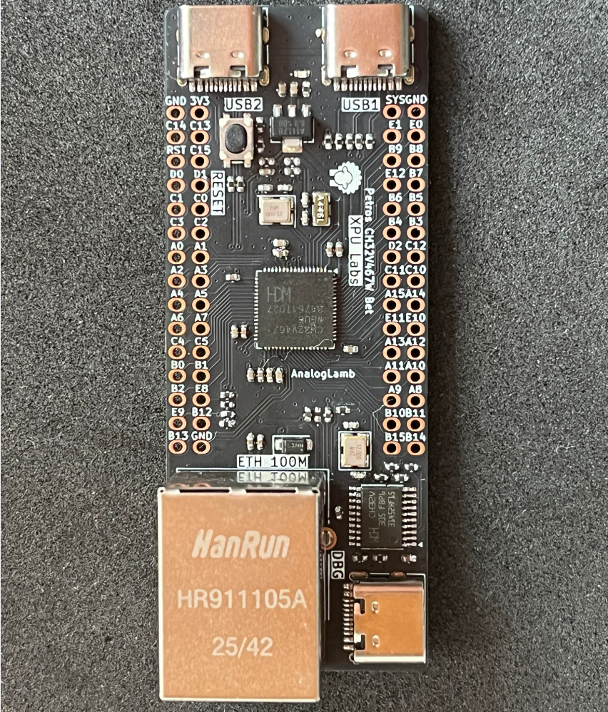
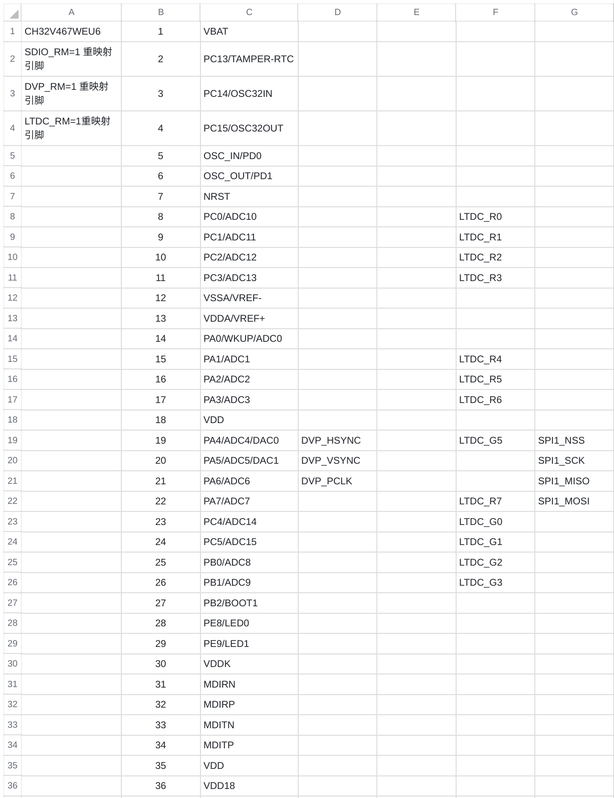
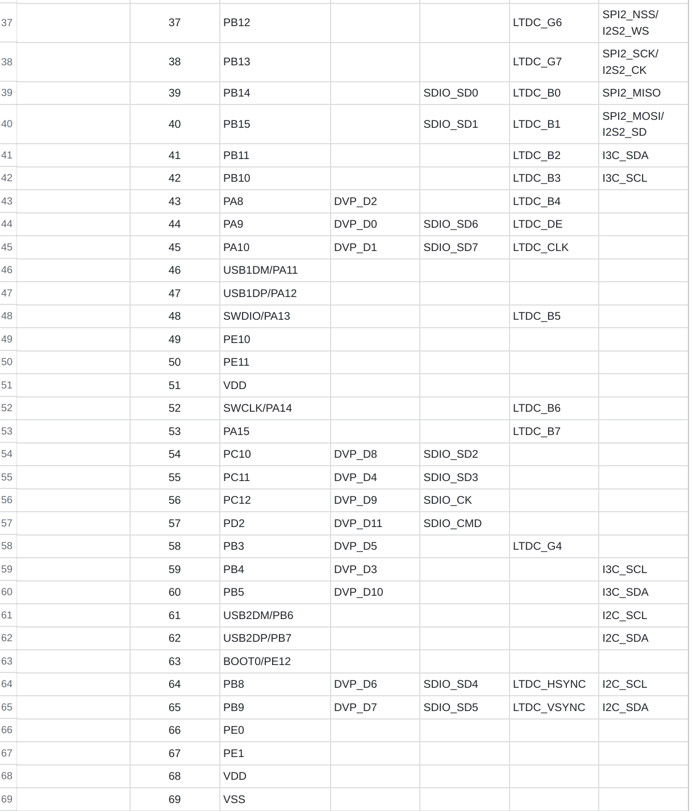
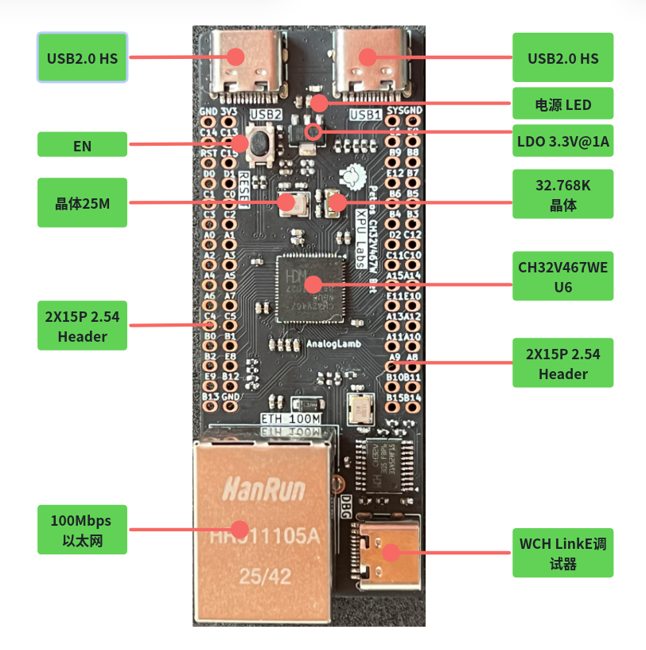
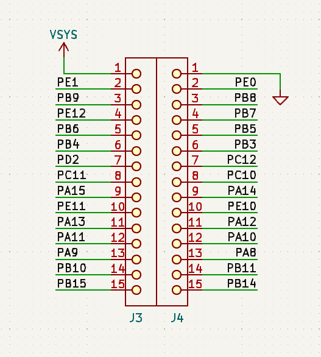
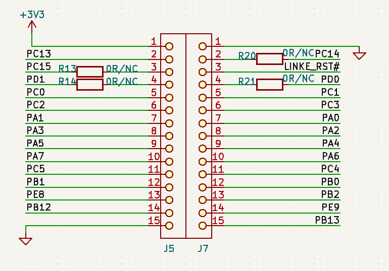

# Petros CH32V467 Bet开发板使用手册

本手册介绍Petros CH32V467 Bet开发板的使用方法。

## 1. 产品介绍 - Overview

CH32V467是由南京沁恒公司开发的32位微控制器，用于开发嵌入式产品。其最大的特点在于支持双USB2.0高速接口与RISC-V架构的向量指令集，同时集成DVP， LCD和8MB PSRAM。正是因为这两个特点，[**XPU实验室**](https://xpulabs.taobao.com)开发了**Petros CH32V467 Bet**开发板。

Petros CH32V467 Bet开发板使用的是CH32V467WEU6微控制器。它是QFN68的封装，板形外观紧凑，其大小为52mm x 21mm。带有两个USB2.0 Type-C母座高速接口，用于开发双USB2.0高速设备。使用芯片100Mbps的以太网接口，可快递实现网络应用开发。为了方便调试开发，板子集成了WCH LinkE 1V3调试器，支持SWD和UART。

## 2. 芯片特点 - Features

- 青稞32位RISC-V3V内核处理器，最高200MHz系统主频

- 支持V向量指令集，支持并行计算

- 200KB SRAM，992KB Flash

- 8MB扩展PSRAM存储器(仅CH32V467)

- 工作电压：2.9~3.6V

- 多种低功耗模式：睡眠/停止/待机

- 上/下电复位、可编程电压监测器

- 2组共24路通用DMA

- 1组运放比较器

- 1个随机数发生器RNG

- 2组12位DAC转换

- 2组12位ADC转换

- 6组定时器

- 2组USB2.0高速主机/设备接口（480Mbps内置PHY）

- 10个USART接口

- 1个CAN接口（2.0B主动）

- SDIO接口（MMC、SD/SDIO卡及CE-ATA）

- FSMC存储器接口

- 150MHz DVP数字图像接口

- LCD-TFT显示控制器LTDC

- 可寻址RGB（ARGB）

- 1组I2C接口、1组I3C接口、3组SPI接口、2组I2S接口

- 内置百兆以太网MAC及10M/100M PHY

- 77个I/O口，可以映射到16个外部中断

- CRC计算单元，96位芯片唯一ID

- 单线或双线调试模式

## 3. 产品规格 - Specifications

- 主芯片：CH32V467WEU6 QFN68 RISC-V核支持向量指令集
- 内部集成8MB PSRAM
- 双USB2.0 HS Type-C接口
- 100Mbps以太网接口
- 板载WCH LinkE 1V3，支持SWD与UART方便调试
- 所有GPIO引到排针
- 复位按键与电源指示
- 尺寸：70mm x 28mm

## 4. 硬件 - Hardware

**CH32V467WEQ6的管脚定义**

**资源接口**

**引脚**

## 5. 软件开发 - Software

CH32V467使用MounRiver II IDE集成开发环境，支持Windows & Linux. 

板载WCH LinkE 1V3，支持SWD与UART，插上USB Type-C线即可使用。

- 产品手册：[CH32V407DS0.PDF](https://www.wch.cn/downloads/CH32V407DS0_PDF.html)

- 集成开发环境(IDE)：[MounRiver Studio(MRS)](http://www.mounriver.com/)

- 技术手册：[CH32V407RM.PDF](https://www.wch.cn/downloads/CH32V407RM_PDF.html)

- SDK: [CH32V407/467 SDK](https://www.wch.cn/downloads/CH32V407EVT_ZIP.html)

## 6. 教程 - Tutorials

- [B站 - CH32H417极速上手系列视频教程](https://space.bilibili.com/402444620/lists?sid=7939010&spm_id_from=333.788.0.0)
  
  - [【5分钟极速上手】CH32H417点灯教程：零基础完成你的第一个嵌入式项目](https://www.bilibili.com/video/BV1AqoFB7ELC/?spm_id_from=333.1387.collection.video_card.click&vd_source=ed48992440952cbd7721bdfd510c25e1)
  
  - [【硬核实测】CH32H417的UHSIF接口到底多快？5分钟带你跑出330MB/s真实速度](https://www.bilibili.com/video/BV1pJovB1EhR/?spm_id_from=333.1387.collection.video_card.click&vd_source=ed48992440952cbd7721bdfd510c25e1)
  
  - [【深度解析】5分钟彻底搞懂CH32H417双核工程！MounRiver的Solution原来这样玩](https://www.bilibili.com/video/BV18rRuBmER6/?spm_id_from=333.1387.collection.video_card.click)
  
  - [CH32H417 10分钟彻底搞懂HSEM！双核同步与通信的终极方案](https://www.bilibili.com/video/BV1TqLJ6CEq9/?spm_id_from=333.1387.collection.video_card.click&vd_source=ed48992440952cbd7721bdfd510c25e1)
  
  - [10分钟彻底搞懂CH32H417中断与事件系统](https://www.bilibili.com/video/BV1SrEd64Edn/?spm_id_from=333.1387.upload.video_card.click)
  
  - [CH32H417 10分钟彻底玩转ADC 从零基础到定时器精确定时采集](https://www.bilibili.com/video/BV13SKS6yELh/?spm_id_from=333.1387.upload.video_card.click)

- B站-相关短视频
  
  - [是CH32H417开发板也是USB3.0逻辑分析仪](https://www.bilibili.com/video/BV1tstZ6JEjD/?spm_id_from=333.1387.upload.video_card.click)
  
  - [USB Type-C的CH32H417开发板&逻辑分析仪来了](https://www.bilibili.com/video/BV1Eda165Edb/?spm_id_from=333.1387.upload.video_card.click)
  
  - [带壳的ch32h417逻辑分析仪，只要几十元，16ch@200MHz](https://www.bilibili.com/video/BV1uYHs6VEQj/?spm_id_from=333.1387.upload.video_card.click)
  
  - [沁恒CH32H417诚不欺我450MB/S速率达到了](https://www.bilibili.com/video/BV1NVNz6vEnd/?spm_id_from=333.1387.upload.video_card.click)

视频持续更新中.....

## 7. 资源 - Resources

- **原理图**

- **例程**

请联系[ **xpulabs.taobao.com** ](https://xpulabs.taobao.com)淘宝店客服

## 8. 常见问题 - FAQ

持续更新中.....
